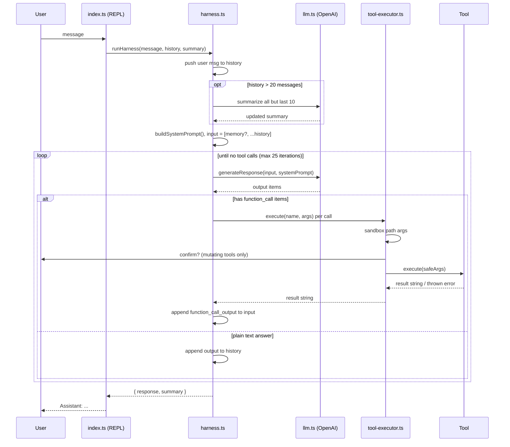

# Mini Harness

A coding agent's runtime, built from scratch in TypeScript to understand what
tools like Claude Code or Cursor's agent mode are actually doing underneath —
no agent framework, no black box. Every piece — the tool-call loop, the
sandboxing, the context summarization — is hand-written and small enough to
read start to finish in one sitting.

> The LLM decides *what* should happen. The harness controls *how* it happens.

---

## What it actually does

You get a terminal chat loop backed by the OpenAI Responses API. The model
can read files, write files, edit files precisely, list directories, search
file contents, and run shell commands — by asking the harness to do it, never
directly. Every mutating action is shown to you and requires a yes/no before
it runs. The conversation persists and self-summarizes as it grows, so long
sessions don't overflow the model's context or your API budget.

```
You: create a fizzbuzz script and run it

 [tool] write_file
[confirm] About to run "write_file": { path: ".../fizzbuzz.ts", content: "..." }
Allow this action? (y/N) y
[tool result] Successfully wrote .../fizzbuzz.ts

 [tool] bash
[confirm] About to run "bash": { command: "bun run fizzbuzz.ts" }
Allow this action? (y/N) y
[tool result] STDOUT: 1 2 Fizz 4 Buzz ...

Assistant: Created fizzbuzz.ts and ran it — output above.
```

---

## Architecture

The harness is split into four layers. Each layer only talks to the one
directly below it, and all side effects go through one place: the tool
executor.

```
┌──────────────────────────────────────────────────────────────────────┐
│  1. Interface layer                                                  │
│     cli.ts      askUser() — one inquirer prompt per turn             │
│     index.ts    REPL: owns `history` + `summary`, handles /help      │
│                 /clear /exit, catches per-turn errors                │
└───────────────────────────────┬──────────────────────────────────────┘
                                │ runHarness(message, history, summary)
┌───────────────────────────────▼──────────────────────────────────────┐
│  2. Orchestration layer — harness.ts                                 │
│     summarizeMessages()  compress old turns once history > 20 msgs   │
│     buildSystemPrompt()  cwd, OS, top-level listing (rebuilt every   │
│                          turn)                                       │
│     agent loop           call model → run tool calls → feed results  │
│                          back → repeat until plain text (max 25)     │
└──────────────┬───────────────────────────────────┬───────────────────┘
               │ generateResponse(input, prompt)   │ execute(name, args)
┌──────────────▼──────────────┐   ┌────────────────▼───────────────────┐
│  3a. Model layer — llm.ts   │   │  3b. Execution layer               │
│  OpenAI Responses API,      │   │      tool-executor.ts              │
│  model "gpt-5", tool        │   │  lookup → sandbox pathArgs →       │
│  schemas from the registry  │   │  confirm if required → execute →   │
│  sent with strict: true     │   │  turn exceptions into results      │
└──────────────▲──────────────┘   └────────────────┬───────────────────┘
               │ tool definitions                  │
┌──────────────┴───────────────────────────────────▼───────────────────┐
│  4. Tool layer — src/tools/                                          │
│     registry.ts   the single list of tools (used by llm + executor)  │
│     types.ts      the Tool contract                                  │
│     read_file · write_file · edit_file · list_files · grep · bash    │
└──────────────────────────────────────────────────────────────────────┘
```

### Request lifecycle

What happens in a single turn, from typing a message to getting an answer:



### Three pieces of state

| State | Lives in | Lifetime | Purpose |
|---|---|---|---|
| `history` | `index.ts`, passed by reference | whole session (until `/clear`) | user messages and the model's final replies, re-sent every turn |
| `summary` | `index.ts`, returned from each turn | whole session (until `/clear`) | compressed memory of turns dropped from `history` |
| `input` | `runHarness()` local | one turn | `history` + memory + this turn's tool calls and tool outputs |

The split between `history` and `input` is deliberate. Tool calls and their
(often large) outputs only live in `input` for the turn that needed them.
Only the user message and the final answer go into the long-lived `history`,
so file dumps and command output don't pile up across turns.

All three use one type, `Message = ResponseInputItem` (the OpenAI SDK's own
union for "things you can send as input"), so raw `response.output` items
can be fed straight back in without conversion.

### Design decisions

- **One choke point for side effects.** Tools are dumb. They only declare
  *which* arguments are paths (`pathArgs`) and *whether* they need approval
  (`requiresConfirmation`). `tool-executor.ts` is the only place that
  enforces sandboxing and asks the user, so every tool, including new ones,
  gets both automatically.
- **One registry, two consumers.** `registry.ts` feeds `llm.ts`, which turns
  each tool into a function schema for the model, and `tool-executor.ts`,
  which dispatches calls by name. The tools the model sees and the tools the
  harness can run can't get out of sync.
- **Errors are data, not crashes.** A failing tool returns `Tool error: ...`
  to the model so it can recover. A failing turn (API error, iteration cap)
  is caught in `index.ts`, so the REPL and its history survive.
- **No framework.** The loop is a plain `while (true)` over the Responses
  API. There are no hidden retries or planners: what the code shows is all
  that happens.

---

## Project structure

```
harness/
├── src/
│   ├── index.ts                  REPL loop, history + summary, slash commands
│   ├── cli.ts                    terminal input (inquirer)
│   ├── harness.ts                agent loop, system prompt, summarization
│   ├── llm.ts                    OpenAI Responses API client + tool schemas
│   ├── types.ts                  Message = SDK ResponseInputItem
│   ├── conversation/
│   │   └── conversation.ts       message-history class (not wired in —
│   │                             harness.ts threads a plain array instead)
│   └── tools/
│       ├── types.ts              Tool contract (parameters, pathArgs, confirm)
│       ├── registry.ts           the single list of available tools
│       ├── tool-executor.ts      sandboxing + confirmation + dispatch
│       ├── read-file.ts
│       ├── write-file.ts
│       ├── edit-file.ts          exact-match, single-occurrence replace
│       ├── list-files.ts
│       ├── grep.ts               recursive text search
│       └── bash.ts               shell exec, timeout + output cap
├── .env                          OPENAI_API_KEY (gitignored)
├── package.json
├── tsconfig.json
├── FUTURE.md                     stage-by-stage status + roadmap
├── REMAINING.md                  what's left before it's "done"
└── README.md
```

---

## The tool contract

Every tool is a plain object, with no inheritance or plugin machinery:

```ts
type Tool = {
  name: string;
  description: string;
  parameters: JSONSchema;          // sent to the model as the function signature
  pathArgs?: string[];             // which args the executor should sandbox-check
  requiresConfirmation?: boolean;  // whether the executor should ask first
  execute: (args) => Promise<string>;
};
```

To add a tool, write the object and add it to `registry.ts`. Nothing else in
the harness has to change, because the executor sandboxes and confirms it
based on those two flags.

| Tool | Confirmation required | Path-sandboxed |
|---|---|---|
| `read_file` | no | yes |
| `write_file` | **yes** | yes |
| `edit_file` | **yes** | yes |
| `list_files` | no | yes |
| `grep` | no | n/a: always searches from the project root, skips `node_modules`, `.git`, `dist`, `build` |
| `bash` | **yes** | n/a: arbitrary shell command |

---

## Safety model

The model can suggest anything; the harness decides what's actually allowed
to happen.

- **Confirm before mutating.** `write_file`, `edit_file`, and `bash` print
  the exact action and arguments and wait for an explicit `y` (default is
  no). A declined call is reported back to the model as skipped.
- **Path sandboxing, enforced once.** `tool-executor.ts` resolves every
  declared path argument against `process.cwd()` and rejects anything that
  lands outside it, which blocks `../../` escapes. The tool then receives the
  resolved absolute path, never the raw one.
- **Bounded shell execution.** `bash` runs with a 30s timeout and a 200KB
  output cap. A timeout or oversized output comes back as a clear message
  instead of hanging the terminal or flooding the conversation.
- **Bounded agent loop.** The tool-call loop in `runHarness` stops after 25
  iterations, so a confused model can't loop forever and burn API budget.
- **Tool errors don't crash the loop.** Per-tool exceptions are returned to
  the model as normal tool results, and per-turn failures are caught by the
  REPL.

---

## Context management

An LLM call is stateless; the harness is what makes it feel like a
conversation. `index.ts` keeps a `history` array and `runHarness` re-sends it,
plus a freshly built system prompt, on every turn.

Left unchecked, that history grows without limit. Once it passes 20
messages, everything except the last 10 is compressed: a separate LLM call
merges the old messages into a running `summary` string (goals, decisions,
constraints, completed work, current task), and those messages are dropped.
The summary is added at the start of every later turn as a
`Conversation memory:` message. This is how the agent still knows what you
were doing 40 messages ago without re-sending 40 messages' worth of tokens
on every turn.

## Environment awareness

The system prompt isn't static. `buildSystemPrompt()` rebuilds it every turn
with the current working directory, detected OS, and a fresh top-level
directory listing, so the model knows where it's working without having to
guess or ask.

---

## Getting started

**Prerequisites:** [Bun](https://bun.sh/) and an OpenAI API key with access
to `gpt-5`.

```bash
git clone <your-repository-url>
cd harness
bun install
```

Create a `.env` file:

```env
OPENAI_API_KEY=your_api_key_here
```

Run it from the directory you want the agent to work in. The sandbox root
is `process.cwd()`:

```bash
bun run dev
```

REPL commands: `/help`, `/clear` (clears history and summary), `/exit`.

---

## Tech stack

| Piece | Choice |
|---|---|
| Language | TypeScript, run directly via Bun (no build step) |
| Model API | OpenAI Responses API (`openai` SDK), model `gpt-5` |
| CLI input | `inquirer` |
| Terminal color | `picocolors` |
| Env config | `dotenv` |

---

## What this project is for

This isn't meant to compete with a production agent framework. It's meant
to be small enough that every layer can be read and understood: how
tool-calling actually works over the wire, why sandboxing has to live in one
shared place instead of in each tool, and why "remembering everything"
eventually needs summarization instead of just sending more tokens. Each of
those was built as a separate, deliberate step rather than taken from a
library.

The honest list of what's still rough is in [REMAINING.md](REMAINING.md),
and the stage-by-stage history and roadmap are in [FUTURE.md](FUTURE.md).
